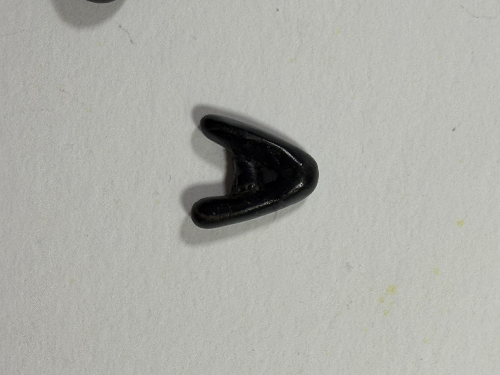
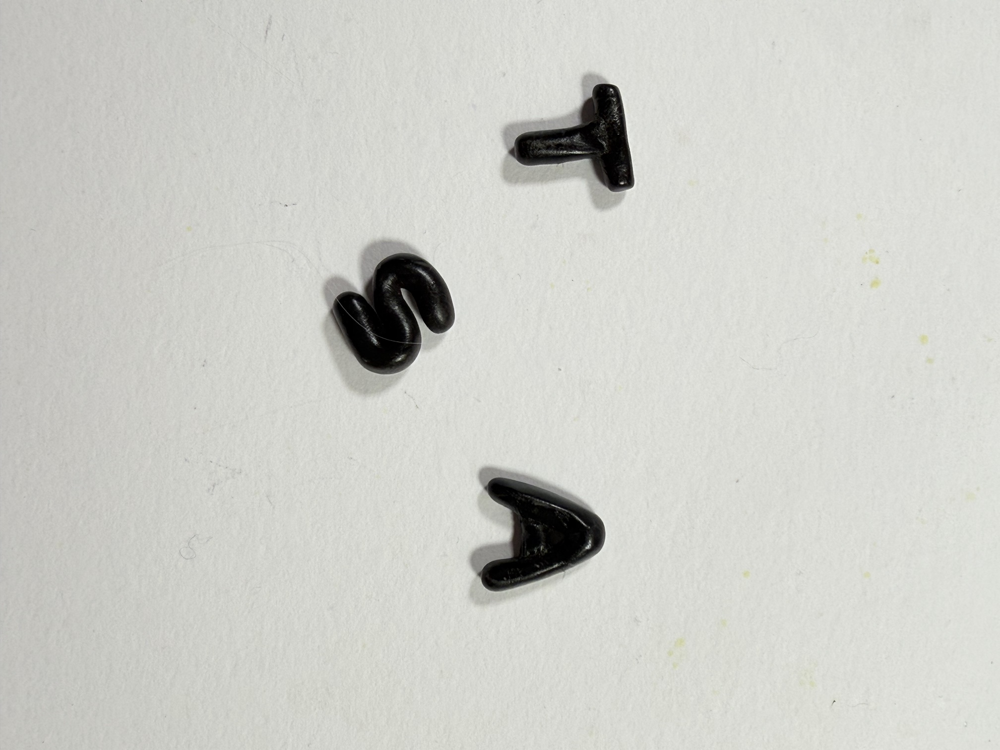
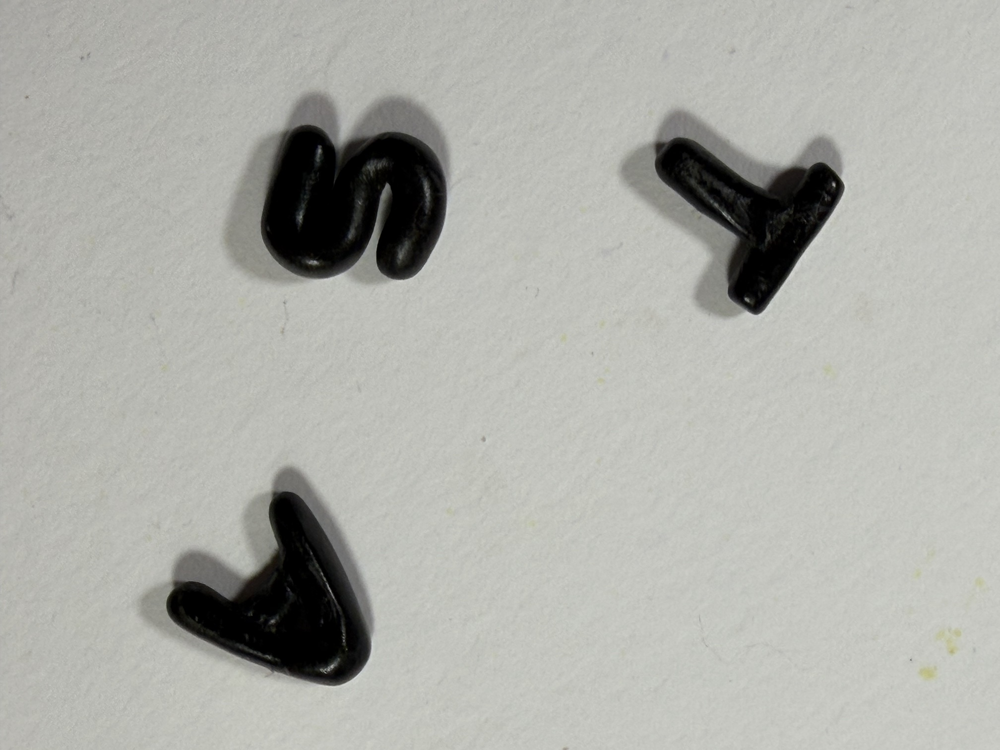
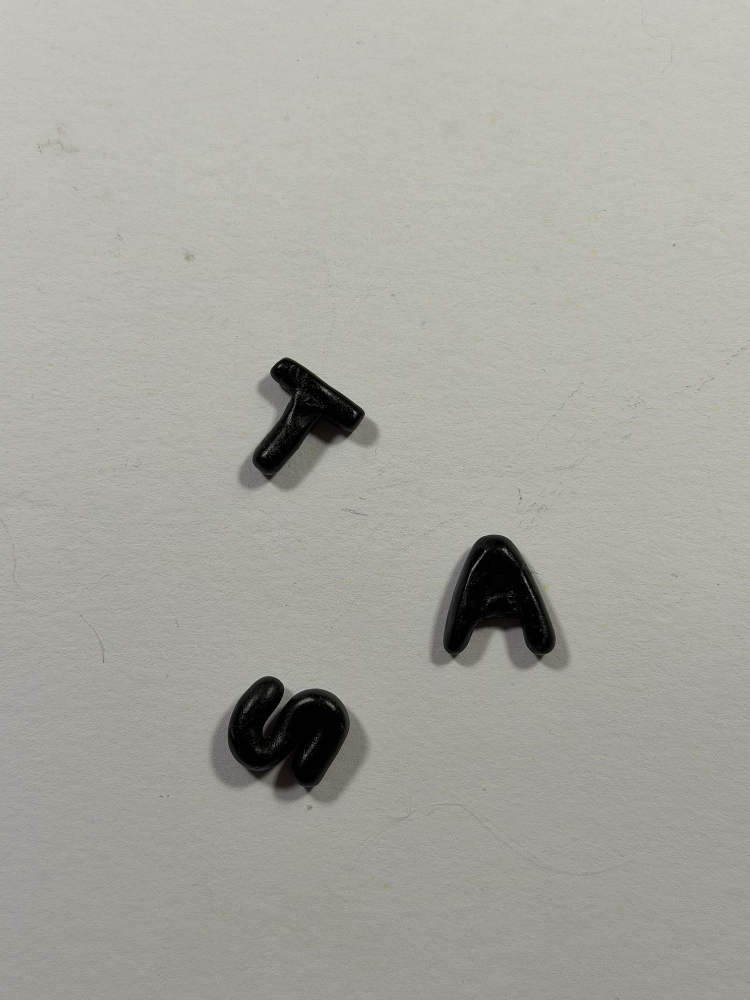
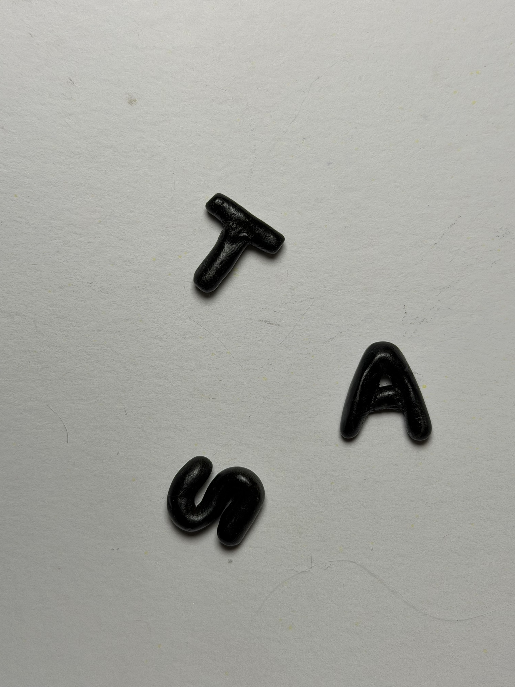

# Process

## 1. The first A

My first A was a closed triangle. It had no clear hole in the middle, so it did not read well as an A.

## 2. The first set of letters

I put the three letters together to see how they work as a group. The T and the S worked, but the A looked too heavy.

## 3. A new A

I made the A again. I opened the space inside the letter, so it looks lighter.

## 4. The final letters

In the final version, the A has a clear crossbar and a hole above it. Now all three letters have the same thick, round stroke.

[Back to the letterform and haiku](index.md)
